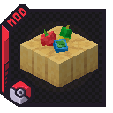

# Cobblemon Faster Snacks

Mod Fabric pour **Cobblemon 1.8.4 (Minecraft 1.21.1)** qui réduit le lag serveur des **Poké Snacks**, sans rien
changer à ce qu'ils font : mêmes Pokémon, aux mêmes endroits, avec les mêmes chances.



## En bref

- Chaque tentative de spawn d'un snack lance tout le pipeline de spawn de Cobblemon sur une zone de 17 × 17 × 17
  blocs, d'un bloc, sur le thread serveur. Le mod rend ce calcul **3,7 à 3,9 fois plus rapide** pour un snack posé
  au sol (médiane de 11 à 12 biomes), et supprime les pics : dans un champ de 64 snacks, plus aucun tick au-delà de
  50 ms (58 sans le mod).
- Un **budget de 10 ms par tick** empêche les snacks de bloquer un tick plus longtemps, en reportant les tentatives
  en trop au tick suivant, sans en perdre aucune.
- **Exact** : chaque optimisation est vérifiable en jeu (`/fastersnacks snacks verify true`) contre le calcul
  d'origine de Cobblemon. 0 différence sur plus d'un milliard de conditions comparées pendant le développement.
- **Ce qu'il ne fait pas** : sur les plateformes de farm dans le ciel, un snack coûte déjà peu, et le lag vient
  surtout des Pokémon accumulés ; le mod y réduit le coût des tentatives (−11 à −26 %) et leurs pics, pas celui des
  Pokémon.

## Installation

- **Serveur** : déposer `cobblemon-faster-snacks-<version>.jar` dans `mods/`, avec Fabric API et Cobblemon.
- **Client** : facultatif. Le mod n'ajoute ni contenu ni échange réseau ; les clients sans le mod se connectent
  normalement. En solo, l'installer côté client suffit (le serveur intégré l'utilise).

| Requis | Version |
|---|---|
| Minecraft | 1.21.1 |
| Fabric Loader | 0.16 ou plus |
| Fabric API | toute version pour 1.21.1 |
| Cobblemon | 1.8.4 (`~1.8.4` : 1.8.4 et suivantes de la branche 1.8) |

Testé avec Lithium, ScalableLux et les mods serveur du pack Tropimon (sauf mega_showdown, qui ne démarrait pas sur
le serveur de test faute de sa dépendance Accessories).

## Ce que fait le mod

Toutes les optimisations sont **exactes** : le snack attire les mêmes Pokémon, aux mêmes endroits, avec les
mêmes probabilités. Rien ne change sur le rayon, la fréquence, les bouchées, les effets d'assaisonnement ou
les événements.

| Optimisation | Principe | Pourquoi c'est identique |
|---|---|---|
| Mémo des conditions (`SpawnMatchMemo`) | Chaque condition intégrée ne lit que quelques attributs de la position (lumière comparée à *ses* bornes, biome, bloc de base, « un bloc voisin correspond à un de *ses* tests »…). Elle est évaluée une fois par valeur distincte de ces attributs, et la réponse est réutilisée pour les autres positions. | Les attributs gardés sont exactement ceux que la condition lit, avec les mêmes comparaisons. Tout ce qui n'est pas connu (conditions d'addons, appendages, bornes X/Z, influences inconnues, positions inconnues) est évalué normalement. |
| Runtime MoLang paresseux (`SpawnablePositionMixin`) | Chaque position construisait un runtime MoLang complet. Il n'est construit qu'au premier accès. | Même objet, mêmes fonctions, dans le même ordre final. |
| Liste de blocs voisins paresseuse (`LazyNearbyBlocks`) | La liste des ~405 blocs autour de chaque position n'est construite que si une condition la lit. | Construite par la méthode d'origine de Cobblemon au premier accès. |
| Dernier choix sans nettoyage (`SingleChoice`) | Après le choix d'un spawn, Cobblemon nettoie ses tables pour le choix suivant de la passe. Un snack ne fait qu'un choix. | L'action est déjà créée, les tables sont jetées juste après, aucun tirage aléatoire n'est consommé. |
| Lumière lue une fois (`SpawningZoneGeneratorMixin`) | Pour chaque bloc de la zone, Cobblemon lit la lumière du ciel, puis appelle `getMaxLocalRawBrightness`, qui la relit. La luminosité est recalculée à partir de la valeur déjà lue. | Même formule que Minecraft 1.21.1 : `max(lumière des blocs, lumière du ciel − assombrissement)`, 15 hors des limites du monde. En mode vérification, chaque valeur est comparée à celle du moteur de lumière (ScalableLux compris). |
| Recherche de joueur inutile (`AreaPositionResolverMixin`) | Pour chaque position proche d'un Pokémon, Cobblemon compare la position de ce Pokémon (un `Vec3`) à l'entité à l'origine du spawn, qu'il va chercher dans la liste des joueurs. | `Vec3.equals` est faux pour tout ce qui n'est pas un `Vec3` : la comparaison est toujours fausse, quelle que soit l'entité. La recherche n'a pas d'effet de bord, elle est donc sautée. |
| Budget de tick des snacks (`SnackScheduler`) | Quand les tentatives de snack d'un même tick ont déjà consommé `snackTickBudgetMs` (10 ms par défaut), les suivantes sont mises en file et rejouées au début des ticks suivants. | Aucune tentative n'est supprimée : chacune est rejouée telle quelle, sur le même snack, avec le joueur le plus proche, quelques ticks plus tard. Le rythme moyen des snacks, y compris accéléré, est inchangé ; seuls les pics sont étalés. |
| Horde sans candidat (`FindHerdLeaderMixin`) | Chaque Pokémon sans chef cherchait régulièrement un chef de horde, même quand son espèce n'accepte aucun chef. | Si la liste des chefs tolérés de l'espèce est vide, la recherche d'origine ne peut rien trouver : on renvoie directement « aucun chef ». |
| Évolution par distance (`PokemonEvolutionCheckMixin`) | `hasBlocksTraveledRequirement` était appelée à chaque tick et construisait des listes intermédiaires. | Même parcours des évolutions et des conditions de la forme actuelle, sans allocation. |
| Préchargement des classes (`ClassPreloader`) | Au démarrage, un fil de basse priorité charge (sans les initialiser) les classes de spawn, d'IA et d'évolution de Cobblemon. | Le chargement est celui que la JVM ferait de toute façon au premier usage ; aucune classe n'est initialisée en avance. |

Les deux correctifs de zone (lumière, recherche de joueur) s'appliquent à tout spawn de zone, donc aussi au spawner
des joueurs, car ils sont exacts partout.

## Résultats mesurés

Versions alternées dans une même série de mesures (seule façon fiable de comparer sur une machine de test) :

| Mesure | Cobblemon seul | Avec le mod |
|---|---|---|
| Tentative d'un snack nature posé au sol, médiane de 12 biomes | 15,9 ms | 4,2 ms (×3,9) |
| Tentative d'un snack vraiment assaisonné (Wacan, Kelpsy, Oran), médiane de 11 biomes | 31,9 ms | 8,3 ms (×3,7) |
| Champ de 64 snacks (×20) : ticks au-delà de 50 ms sur 4 800 | 58 | 0 |
| Champ de 64 snacks : tick au 99e centile | 52,2 ms | 16,6 ms |
| Plateforme dans le ciel, plafond 2, snacks ×20 : tentative moyenne | 0,139 ms | 0,106 ms (−24 %) |
| Plateforme, plafond 15 : tentative moyenne | 1,086 ms | 0,965 ms (−11 %) |
| Plateforme : pire tentative | 39,7 à 44,0 ms | 13,0 à 15,8 ms |

Le diagnostic complet, les protocoles et toutes les séries sont dans [docs/MESURES.md](docs/MESURES.md).

## Configuration

`config/cobblemon_faster_snacks.json`, créé au premier démarrage :

| Clé | Défaut | Rôle |
|---|---|---|
| `optimizeSnacks` | `true` | Optimisations des snacks et des zones de spawn. `false` = pipeline de spawn d'origine. |
| `optimizeEntities` | `true` | Optimisations des Pokémon sauvages (horde, évolution). |
| `preloadClasses` | `true` | Préchargement des classes Cobblemon au démarrage du serveur. |
| `snackTickBudgetMs` | `10.0` | Temps maximal des snacks par tick avant report au tick suivant. `0` = pas de budget. |
| `lazyPositionRuntime` | `true` | Runtime MoLang paresseux. |
| `lazyNearbyBlocks` | `true` | Listes de blocs voisins paresseuses. |
| `optimizeAllAreaSpawners` | `false` | Applique aussi le mémo au spawner des joueurs (mêmes garanties, non mesuré). |
| `verifySnackOptimizations` | `false` | Calcule les deux résultats et compte les différences. Plus lent : pour contrôler, pas pour jouer. |

## Commandes (permission 3)

Les changements faits par commande sont enregistrés dans le fichier de config.

- `/fastersnacks stats [reset]` : temps des tentatives de snack, efficacité du mémo, différences de conditions
  relevées en mode vérification, tentatives reportées par le budget.
- `/fastersnacks optimize [true|false]` : toutes les optimisations (snacks et Pokémon), à chaud.
- `/fastersnacks snacks optimize [true|false]` : les seules optimisations de snack, à chaud.
- `/fastersnacks snacks verify [true|false]` : mode vérification.
- `/fastersnacks debug timings <true|false>` : détail des temps internes du mémo.

## Limites connues

- Écrit et mesuré contre Cobblemon 1.8.4. Une autre version peut changer les classes ciblées : les mixins échouent
  alors au démarrage plutôt que de se tromper en silence. À revérifier (mode vérification) à chaque mise à jour de
  Cobblemon.
- Les conditions et influences ajoutées par d'autres mods sont évaluées sans mémo : correct, mais sans gain.
- Les positions influencées par un bloc Habitat de Cobblemon sont évaluées sans mémo (son influence lit la position).
- Le gel de 250 à 280 ms à la toute première tentative après un redémarrage vient du chargement et de la
  compilation à chaud du code de spawn par la JVM ; le préchargement n'en retire qu'environ 10 %.
- Le tick des Pokémon sauvages n'est pas sensiblement réduit : l'essentiel de ce coût est dans Minecraft lui-même.

## Développement

```
./gradlew build                      # jar de production : build/libs/cobblemon-faster-snacks-<version>.jar
./gradlew build -Pbench              # jar de banc : ajoute /fastersnacks bench (mondes de test uniquement)
./gradlew deployToBench -Pbench      # copie le jar de banc dans le serveur de banc local
./gradlew deployToInstance           # copie le jar de production dans l'instance Prism Tropimon
```

Le jar de Cobblemon est lu depuis l'instance Tropimon (`gradle.properties`, `cobblemon_jar`). Le code de banc vit
dans `src/bench` et n'entre jamais dans le jar de production. Ses commandes (`micro`, `macro`, `platform`,
`platformab`, `alternateattempts`, `status`, `cancel`) écrivent leurs résultats en JSON dans `fastersnacks-bench/`
et posent des blocs, des joueurs fictifs et suppriment des entités : jamais sur un serveur de jeu.

`tools/icon/` contient le générateur de l'icône (rendu 3D du Poké Snack assaisonné à partir des modèles et textures
de Cobblemon, dans le cadre d'addon Cobblemon).
